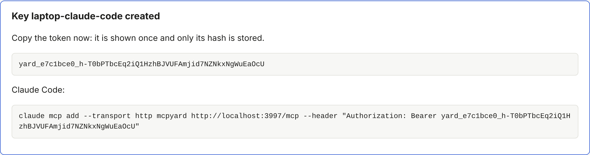

# Getting started

Run the hub, declare a server, create a key, connect a client. Five minutes, one container.

## 1. Write the server file

```yaml
# mcpyard.yaml
servers:
  time:
    package: { pypi: mcp-server-time }
  memory:
    package: { npm: "@modelcontextprotocol/server-memory" }
```

Each server is a package the hub installs, a command it spawns, or a URL it connects to. See
[Server file](configuration.html) for everything a server can declare.

## 2. Start the container

For a first try on your own machine, run it without sign-in and only on localhost:

```bash
docker run -d --name mcpyard \
  -p 127.0.0.1:3000:3000 \
  -e MCPYARD_UI_AUTH=none \
  -v ./mcpyard.yaml:/config/mcpyard.yaml:ro \
  -v mcpyard-data:/data \
  ghcr.io/cedhuf/mcpyard:latest
```

The first start installs each package into the data volume; later starts reuse it. Follow along with
`docker logs -f mcpyard`.

> `MCPYARD_UI_AUTH=none` lets anyone who reaches the port manage the hub. For anything beyond a local
> trial, put the UI behind your identity provider: see [Web UI and sign-in](web-ui.html).

## 3. Create a key

Open [http://localhost:3000](http://localhost:3000), check that both servers are **ready**, then open
**Keys** and create one for your client. The token is shown once, with the command to add it to
Claude Code:

<picture>
  <source srcset="assets/token-dark.png" media="(prefers-color-scheme: dark)">
  
</picture>

## 4. Connect a client

```bash
claude mcp add --transport http mcpyard http://localhost:3000/mcp \
  --header "Authorization: Bearer yard_..."
```

Any client that speaks streamable HTTP works the same way: one URL, one bearer token. Tools appear as
`<server>-<tool>`, for example `time-get_current_time`.

## Next

- [Deployment](deployment.html): Docker Compose, reverse proxy, TLS.
- [Packages and updates](packages.html): pin versions or let the hub track them.
- [Keys and scopes](keys.html): give each client only what it needs.
