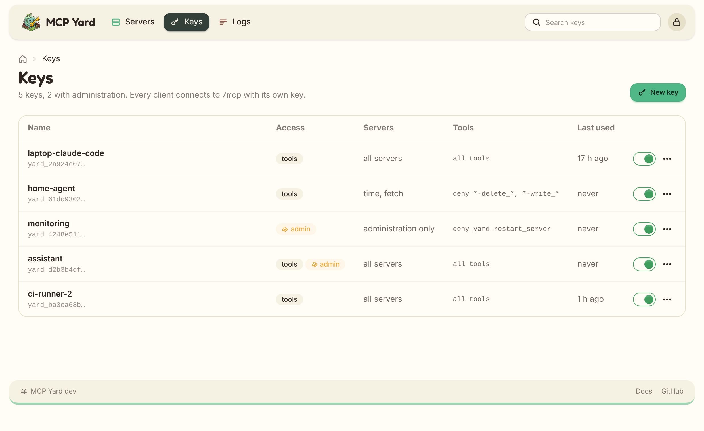

# Keys and scopes

Every client gets its own bearer key. A key decides which servers and which tools the client sees,
and the hub refuses calls to anything else.

## Creating keys

In the web UI, open **Keys**, name the key after the client (`laptop-claude-code`, `home-agent`), pick
its servers and tool filters, and create it. The token is displayed once; only its SHA-256 hash is
stored, in `$MCPYARD_DATA_DIR/keys.json`.

<picture>
  <source srcset="assets/keys-dark.png" media="(prefers-color-scheme: dark)">
  
</picture>

Without the web UI, generate one from the container and add the printed entry to `keys.json`:

```bash
docker exec mcpyard node src/main.ts keygen laptop-claude-code   # add admin as a third argument for hub administration
```

**Edit** renames a key or changes its scope; its token stays the same. To rotate a token, create a
new key and delete the old one. Disabling, editing or deleting a key takes effect on the next request:
the file is read for every call.

The **Last used** column shows when each key last authenticated, recorded at most once an hour.

## Scopes

```json
"scope": {
  "servers": ["time", "mail"],
  "tools": { "deny": ["*-delete_*", "mail-send_*"] }
}
```

- `servers` lists the servers the key reaches; `*` means all, including servers added later.
- `tools` holds `allow` and `deny` globs on the **exposed** names (`<server>-<tool>`). A tool must match
  `allow` when it is set, and must not match `deny`.

Hidden tools are absent from `tools/list` and refused on `tools/call`, so a client cannot call what it
cannot see.

Server-level `tools` filters in the [server file](configuration.html) apply first, to every key.

## Hub administration

Switch on **Hub administration** on a key to give it MCP Yard's own `yard-*` tools as well, on the same
`/mcp` connection: listing, restarting and updating servers, reloading the server file. It sits apart
from the servers in the form on purpose, and no key gets it unless you switch it on. See
[Hub administration](admin.html).

## Audit log

Every tool call is written to standard output as one JSON line:

```json
{"event":"tool_call","time":"2026-10-12T09:14:03.120Z","key":"laptop-claude-code","tool":"time-get_current_time","ok":true,"ms":42}
```

Actions from the web UI are logged the same way, with the signed-in user in `by`:

| Event | When |
| --- | --- |
| `key_created`, `key_updated`, `key_enable`, `key_disable`, `key_delete` | A key changes. |
| `server_added`, `server_updated`, `server_deleted` | A server form is saved, or a server removed. |
| `server_enabled`, `server_disabled` | A server is switched on or off. |
| `server_restarted`, `package_update` | A server is restarted or a package updated. |
| `config_reloaded`, `settings_saved` | The server file is reloaded, or the settings saved. |
| `health_check`, `updates_checked`, `update_all` | The dashboard runs a health check, asks the registries, or updates everything. |
| `server_answering`, `server_not_answering` | The periodic health check sees a server stop or start answering again. |

Ship the container logs wherever you keep logs. The web UI's [Logs](web-ui.html#logs) page shows the
recent ones, with a tab for MCP calls.
