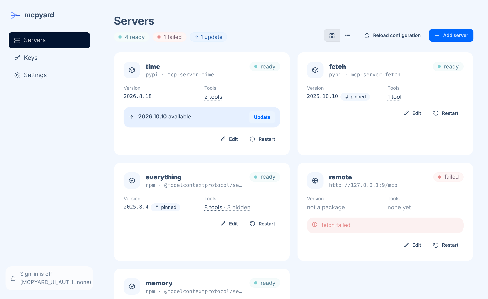

# Packages and updates

The hub installs package servers itself, so you always know which version runs, and you choose when it
changes.

```yaml
servers:
  time:
    package: { pypi: mcp-server-time }               # hub-owned version
  memory:
    package: { npm: "@modelcontextprotocol/server-memory", version: "2026.8.31" }   # pinned
```

## How packages are installed

Every version gets its own directory, `$MCPYARD_DATA_DIR/packages/<server>/<version>/`:

- **npm**: `npm install --ignore-scripts` into that directory, then the bin runs from `node_modules/.bin`.
- **PyPI**: a dedicated virtualenv created by `uv`, then `uv pip install --no-build`; the script runs
  from the venv's `bin`. In the Docker image, `uv` downloads the Python interpreter into the data
  volume on first use.

There is no `npx -y` and no `uvx`: nothing resolves a version behind your back, and processes are
spawned without a shell.

### Choosing the bin

When a package ships one executable, the hub uses it. When it ships several, name the one to run:

```yaml
package: { npm: "@example/tools", bin: example-mcp }
```

### Install-time code

By default no package code runs at install time: npm lifecycle scripts are skipped and Python
packages must come as wheels. A package that needs a build step fails with the installer's message
until you opt in:

```yaml
mail:
  package: { pypi: some-mcp-server }
  allowScripts: true
```

Install scripts run with the same scrubbed environment as servers, plus proxy and registry settings.

## Pinned or hub-owned

Each server has exactly one source of truth for its version.

**Pinned**: `version` is set in the file. That version runs, and only an edit to the file changes it.
Once a newly pinned version is installed, the directories of versions pinned before are deleted.

**Hub-owned**: `version` is omitted. The first start installs the registry's latest version and
records it in `$MCPYARD_DATA_DIR/versions.json`. Later starts reuse the recorded version, so a restart
never upgrades anything.

## Checking for updates

Every `MCPYARD_VERSION_CHECK_HOURS` hours (6 by default; off, 6 hours, a day, a week or a month in
Settings) the hub asks npm and PyPI for the latest
version of each package, once per package. The web UI and the admin endpoint show the installed and
latest versions side by side. **Nothing is updated automatically** unless you ask for it.

## Nightly updates

Switch on **Settings > Updates > Update automatically** and pick a time (2:00 by default), or set
`MCPYARD_AUTO_UPDATE=true` and `MCPYARD_AUTO_UPDATE_TIME=02:00`. Once a day at that time the hub asks the registries, then updates every hub-owned
package that has a newer version, with the same safe flow as **Update**. Pinned packages never move.
It is off by default.

The time is the hub's local time: set `TZ` in the container (for example `TZ=Europe/Paris`), or it
runs in UTC. The dashboard clock shows which zone the hub uses.

## Updating and rolling back

Click **Update** in the web UI. The hub then:

1. installs the new version into its own directory,
2. starts it **next to the running one**,
3. waits for it to initialize and list its tools,
4. switches traffic to it and stops the old process,
5. records the new version, keeping the previous one for rollback.

If any step fails, the old version keeps serving and the error is shown on the server. **Roll back**
runs the same flow towards the previous version. Older version directories are deleted.

<picture>
  <source srcset="assets/servers-dark.png" media="(prefers-color-scheme: dark)">
  
</picture>
