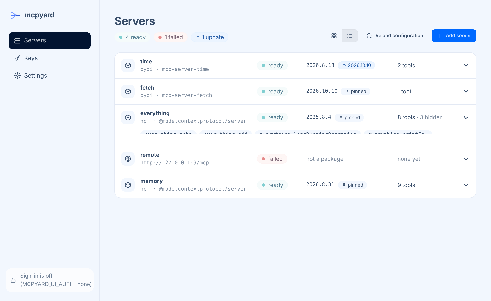
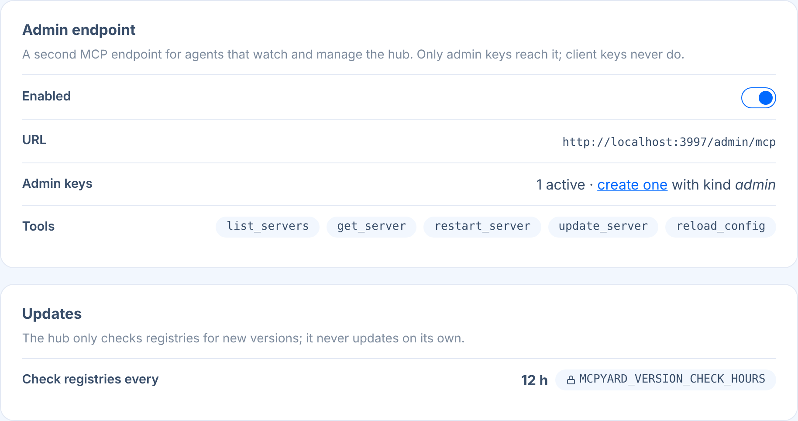

# Web UI and sign-in

The web UI is served at the root of the hub. It shows each server's state, tools and versions,
restarts servers, updates and rolls back packages, reloads the server file, and creates, edits,
disables and deletes keys. It refreshes itself every few seconds.

<picture>
  <source srcset="assets/servers-dark.png" media="(prefers-color-scheme: dark)">
  
</picture>

## Cards or list

The servers page has two layouts, switched with the buttons next to **Reload configuration** and
remembered in a cookie: **cards**, one per server, and a compact **list** where each row unfolds to
show the server's tools, its error and its actions.

<picture>
  <source srcset="assets/servers-list-dark.png" media="(prefers-color-scheme: dark)">
  
</picture>

The UI is built with [daisyUI](https://daisyui.com) and follows your system's light or dark theme.
It needs no build step and no external request: the hub serves its own stylesheet.

## Servers from the UI

**Add server** and **Edit** open a form for any kind of server: npm or PyPI package, command, or
remote URL, with its arguments, environment, headers and tool filters. Saving rewrites the server
file and restarts only that server.

- Comments elsewhere in the file and `${VAR}` references are kept as written.
- The whole file must still be valid, or nothing is written and the error is shown.
- If the file is read-only (a `:ro` mount, or not writable by uid 1000), the forms are shown locked
  and the file stays yours to edit by hand; **Reload configuration** applies it.

## Settings

The **Settings** page gathers what is not a server or a key:

- **Admin endpoint**: on or off, the URL to give agents, and how many admin keys exist.
- **Updates**: how often registries are checked.
- **Environment**: every startup variable with its value, behind a padlock. Secrets are masked.

A setting whose environment variable is set shows a padlock and cannot be changed from the page:
the environment always wins.

<picture>
  <source srcset="assets/settings-dark.png" media="(prefers-color-scheme: dark)">
  
</picture>

## Sign-in with OpenID Connect

There is no local password. The UI signs you in through your identity provider with the
authorization code flow and PKCE, and verifies the ID token's signature, issuer, audience, expiry and
nonce.

```bash
MCPYARD_PUBLIC_URL=https://mcpyard.example.lan
OIDC_ISSUER=https://id.example.lan
OIDC_CLIENT_ID=mcpyard
OIDC_CLIENT_SECRET=...
OIDC_ALLOWED_GROUPS=mcpyard-admins   # optional
```

In your provider, register a client with:

- **Redirect URI**: `<MCPYARD_PUBLIC_URL>/auth/callback`
- **Scopes**: `openid profile email`, plus `groups` when you use `OIDC_ALLOWED_GROUPS`
- **Client authentication**: client secret (basic or post), or a public client with no secret

Sessions last 12 hours in a signed, HTTP-only cookie. The signing key is generated in
`$MCPYARD_DATA_DIR/session.key`; delete it and restart to sign everyone out.

### Who may sign in

Anyone your provider lets through for this client. Restrict it in the provider, or set
`OIDC_ALLOWED_GROUPS`: the ID token's `groups` claim must then contain one of the listed groups.

## Provider examples

### PocketID

Under **OIDC Clients**, add a client named `mcpyard` with the callback URL above. Copy the client id
and secret into the environment. Use the client's allowed user groups to choose who may sign in.

### Authelia

```yaml
identity_providers:
  oidc:
    clients:
      - client_id: mcpyard
        client_name: mcpyard
        client_secret: "$pbkdf2-sha512$..."   # authelia crypto hash generate pbkdf2
        authorization_policy: two_factor
        redirect_uris: [https://mcpyard.example.lan/auth/callback]
        scopes: [openid, profile, email, groups]
        token_endpoint_auth_method: client_secret_basic
        require_pkce: true
        pkce_challenge_method: S256
```

### Keycloak

Create an OpenID Connect client with **Client authentication** on and **Standard flow** enabled, and
set the valid redirect URI. The secret is on the **Credentials** tab. To use
`OIDC_ALLOWED_GROUPS`, add a **Group Membership** mapper with the claim name `groups` and
**Full group path** off to the client's dedicated scope.

## Without sign-in

Without the OIDC variables the UI is off: only `/mcp`, `/admin/mcp` and `/healthz` answer.

`MCPYARD_UI_AUTH=none` serves the UI to anyone who reaches the port. Use it for a local trial, on a
network you trust, or behind a proxy that already authenticates. The hub prints a warning at startup
as a reminder.

## Protections

- Forms are accepted only from the hub's own origin, and cookies are `SameSite=Lax`.
- A strict Content Security Policy allows no inline handlers and only the page's own script, through
  a per-request nonce.
- The UI never shows a token after creation.
